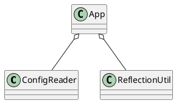

## 2.1 容器基本用法
1. 新建一个pojo
```java
public class MyBean {
    private String str = "hello";

    /**
     * Getter method for property <tt>str</tt>.
     *
     * @return property value of str
     */
    public String getStr() {
        return str;
    }

    /**
     * Setter method for property <tt>str</tt>.
     *
     * @param str value to be assigned to property str
     */
    public void setStr(String str) {
        this.str = str;
    }
}
```
2. 增加配置文件
```xml
<?xml version="1.0" encoding="UTF-8" ?>
<beans
        xmlns="http://www.springframework.org/schema/beans"
        xmlns:xsi="http://www.w3.org/2001/XMLSchema-instance"
        xsi:schemaLocation="http://www.springframework.org/schema/beans
                            http://www.springframework.org/schema/beans/spring-beans-3.0.xsd">

    <bean id="myTestBean" class="com.fzw.thinkinginspring.MyBean"/>

</beans>
```
3. 使用bean进行测试
```java
public class BeanFactoryTest {

    @Test
    public void testSimpleLoad() {
        BeanFactory beanFactory = new XmlBeanFactory(new ClassPathResource("beanFactory.xml"));
        MyBean myBean = (MyBean)beanFactory.getBean("myTestBean");

        System.out.println(myBean.getStr());
    }
}
```

## 2.2 功能分析
对于2.1中测试类完成的内容，可以归纳为：

- 读取配置文件
- 根据配置文件中的配置找到类配置，并进行实例化
- 调用实例的方法

为了完成这些步骤，那么spring需要完成：读取文件、实例化。我们假设需要这些类：

- ConfigReader：读取&验证配置文件
- ReflectionUtil：对配置文件中的配置进行反射实例化
- App：完成完整逻辑的串联


## 2.4 spring的结构组成
### 2.4.1 beans包的层级机构
### 2.4.2 核心类介绍
#### 2.4.2.1 DefaultListableBeanFactory
XmlBeanFactory继承自DefaultListableBeanFactory，而DefaultListableBeanFactory是整个bean加载的核心部分，是spring注册及加载bean的默认实现

#### 2.4.2.2 XmlBeanDefinition
Xml配置文件的读取是Spring非常重要的功能，因为Spring大部分功能都是以配置作为切入点的。这部分涉及到的重点是：
- ResourceLoad：定义资源加载器，主要应用于根据给定的资源文件地址返回对应的Resource。
- BeanDefinitionReader：主要定义资源文件读取并转换为BeanDefinition的各个功能。
- EnvironmentCapable：定义获取Environment方法。
- DocumentLoader：定义从资源文件加载到转换为Document的功能。
- AbstractBeanDefinitionReader：对EnvironmentCapable、BeanDefinitionReader类定义的功能进行实现。
- BeanDefinitionDocumentReader：定义读取Document并注册BeanDefinition功能。
- BeanDefinitionParserDelegate：定义解析Element的各种方法。

1. 通过继承自AbstractBeanDefinitionReader中的方法，来使用ResourceLoader将资源文件路径转换为对应的Resource文件；
2. 通过DocumentLoader对Resource文件进行转换，将Resource文件转换为Document文件；
3. 通过实现接口BeanDefinitionDocumentReader的DefaultBeanDefinitionDocumentReader类对Document进行解析，并使用BeanDefinitionParserDelegate对Element进行解析。
## 2.5 容器的基础XmlBeanFactory
```java
BeanFactory beanFactory = new XmlBeanFactory(new ClassPathResource("beanFactory.xml"));
```
首先调用ClassPathResource的构造函数来构造Resource资源文件的实例对象，这样后续的资源服务就可以使用Resource提供的服务来操作了，当有了Resource后就可以进行XmlBeanFactory的初始化了。
### 2.5.1 配置文件封装
在java中将不同的资源抽象为URIL，通过注册不同的handler（URLStreamHandler）来处理不同来源的资源的读取逻辑。
对于不同来源的资源文件都有对应的Resource实现：
- 文件：FileSystemResource
- ClassPath：ClassPathResource
- URL资源：URLResource
- InputStream：InputStreamResource
在日常开发中，资源文件加载也很常见，可以使用Spring提供的类。
```java
Resource resoure = new ClassPathResource("beanFactory.xml");
InputStream in = resoure.getInputStream();
```
XmlBeanFactory.java
```java
// as of Spring 3.1 in favor of DefaultListableBeanFactory and XmlBeanDefinitionReader
public class XmlBeanFactory extends DefaultListableBeanFactory {
	private final XmlBeanDefinitionReader reader = new XmlBeanDefinitionReader(this);
	
	/**
	 * Create a new XmlBeanFactory with the given resource,
	 * which must be parsable using DOM.
	 * @param resource the XML resource to load bean definitions from
	 * @throws BeansException in case of loading or parsing errors
	 */
	public XmlBeanFactory(Resource resource) throws BeansException {
		this(resource, null);
	}

	/**
	 * Create a new XmlBeanFactory with the given input stream,
	 * which must be parsable using DOM.
	 * @param resource the XML resource to load bean definitions from
	 * @param parentBeanFactory parent bean factory
	 * @throws BeansException in case of loading or parsing errors
	 */
	public XmlBeanFactory(Resource resource, BeanFactory parentBeanFactory) throws BeansException {
		super(parentBeanFactory);
		this.reader.loadBeanDefinitions(resource);
	}
}
```
this.reader.loadBeanDefinitions(resource)才是资源加载的真正实现，也是分析重点之一。

# 2.6 获取XML的验证模式
xml文件的验证模式保证了xml的正确性，常见的有：DTD和XSD。


# 2.7 获取Document
&ensp;首选创建DocumentBuilderFactory，然后通过DocumentBuilderFactory创建DocumentBuilder，然后解析inputSource来返回Document对象。关于对inputSource的解析。交给domParser去处理，涉及到dom解析的部分就不再展开。
```java
@Override
public Document loadDocument(InputSource inputSource, EntityResolver entityResolver,
      ErrorHandler errorHandler, int validationMode, boolean namespaceAware) throws Exception {

   DocumentBuilderFactory factory = createDocumentBuilderFactory(validationMode, namespaceAware);
   if (logger.isTraceEnabled()) {
      logger.trace("Using JAXP provider [" + factory.getClass().getName() + "]");
   }
   DocumentBuilder builder = createDocumentBuilder(factory, entityResolver, errorHandler);
   return builder.parse(inputSource);
}
```
